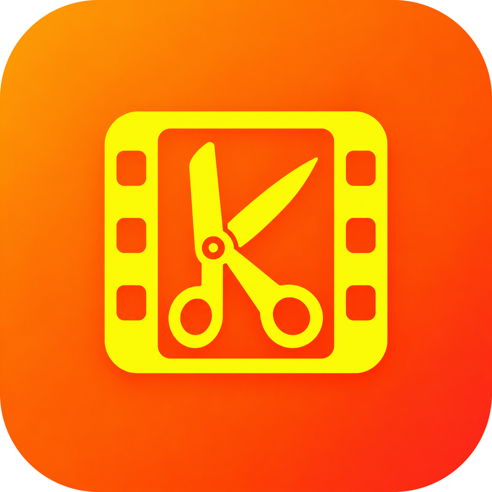

<p align="center">
  
</p>

<h1 align="center">Klippo para Windows</h1>

<p align="center"><b>Español</b> · <a href="README.en.md">English</a></p>

<p align="center">
  <b>Descarga, recorta y comparte vídeos de YouTube, TikTok, X, Instagram y Facebook.</b><br>
  Sin publicidad. Sin cuentas. Sin restos en tu disco.<br>
  Los vídeos se borran solos: Klippo vacía su carpeta temporal cada hora.
</p>

<p align="center">
  <a href="https://github.com/rboluda/KlippoDesktop/releases/latest"><b>⬇️ Descargar el instalador</b></a>
</p>

---

Es la versión de escritorio de [Klippo para Android](https://github.com/rboluda/Klippo): la
misma idea, los mismos colores y lo aprendido allí sobre cada plataforma.

> Hace lo mismo que la app de Android, adaptado al escritorio.

## Qué hace

- **Descargar** de YouTube, TikTok, X, Instagram y Facebook (y muchas webs más) con yt-dlp, en
  H.264 + AAC para que el vídeo se vea y se comparta en cualquier sitio. Eliges la calidad en
  cada vídeo: mejor, 1080p, 720p, 480p o solo audio en **M4A** (sin recodificar) o en **MP3**
  (VBR V0, unos 245 kbps). Los audios llevan dentro la carátula, el título y el artista y, en
  las listas, el álbum (el nombre de la lista) y el número de pista. En TikTok solo se usan formatos con
  imagen y sonido juntos, y si un vídeo llega mudo Klippo lo vuelve a pedir con otro formato.
- **Listas de reproducción** de YouTube (un enlace `youtube.com/playlist?list=…`, hasta 100
  elementos) y **carruseles** de Instagram y X (hasta 20): la barra avanza sobre el total
  («40 % · 4 de 10») y la lista ocupa una sola tarjeta con **Guardar todo**
  (`Descargas\Klippo\<lista>\` con cada archivo con su título), **Compartir**, **Copiar** y
  **WhatsApp** de todos a la vez; «Ver uno a uno» la despliega. Si algún vídeo es privado o se
  ha borrado, se bajan los demás.
- **Desde Spotify**: pega (o arrastra, o envía con el marcador) un enlace de una lista, un
  álbum o una canción de Spotify. Klippo lee sus canciones sin cuenta, busca cada una en
  YouTube y te dice si lo encontrado es **idéntico** (mismo título, intérprete y duración),
  **parecido** o no está; pulsando una fila abres el vídeo para comprobarlo. «Descargar todas»
  baja el audio (M4A o MP3, en *Ajustes*) con el título, el artista, el álbum, el número de
  pista y la portada de Spotify dentro, con el nombre `Artista - Título` (en una lista o un álbum, con el número delante: `04 - Artista - Título`). Se bajan dos a la vez
  («En cola» el resto); si un vídeo falla se prueba con otro de los encontrados. Con «Guardar
  al terminar» cada canción va sola a `Descargas\Klippo\<lista>\`, y «Ver en el Explorador»
  abre esa carpeta. Sin cuenta, Spotify solo enseña las 100 primeras canciones de una lista:
  si tiene más, Klippo te avisa.
- **Sesión opcional** en Instagram, X y Facebook para los vídeos que la piden
  (*Ajustes → Cuentas*, o el botón de la descarga fallida). Se abre la web oficial en una
  ventana; Klippo nunca ve tu contraseña y solo guarda las cookies, en tu equipo.
- Tema claro, oscuro o el de Windows. Si el motor tiene más de un mes, Klippo sugiere
  actualizarlo.
- Progreso con tiempo restante, cancelar, reintentar y, si una plataforma cambia, **Actualizar
  motor y reintentar** desde la propia tarjeta. Lista o mosaico con miniaturas.

- **Del navegador a Klippo sin extensiones**, en Chrome, Edge, Opera, Firefox o cualquier otro:
  - **Copia el enlace.** Si Klippo está delante, aparece en el campo; si está detrás o en la
    bandeja, un aviso de Windows te ofrece descargarlo. Nunca descarga solo.
  - **Marcador «Enviar a Klippo».** Un botón en la barra de marcadores que manda a Klippo el
    vídeo de la pestaña con un clic (*Ajustes → Desde el navegador → Instalar*).
  - O arrastra la pestaña hasta la ventana de Klippo, o pulsa Ctrl+V en ella.
  - Con *Iniciar con Windows*, Klippo espera en la bandeja sin abrir la ventana.
- **Compartir** desde cada vídeo: WhatsApp (copia el vídeo y abre WhatsApp: eliges el chat y
  pulsas Ctrl+V), el menú Compartir de Windows, Copiar (para pegarlo donde quieras) o
  arrastrar la miniatura a otra app o a una carpeta.
- **Guardar** crea `Descargas\Klippo\<título del vídeo>.mp4` (o `.m4a`, `.mp3`), con
  `klippo_<fecha>` solo si no tiene título; si ya existe, añade « (1)», « (2)»… Si no lo pulsas,
  el vídeo nunca sale de la carpeta temporal de Klippo.
- Aviso de Windows al terminar cada descarga si Klippo no está delante, con WhatsApp, Copiar y
  Guardar.

- **Editar** (pulsa la miniatura o el lápiz):
  - Recortar arrastrando los tiradores o escribiendo el inicio y el fin a la décima, con vista
    previa en bucle del tramo.
  - Encuadre 9:16, 1:1, 4:5 o libre: mueve y ajusta el marco sobre el vídeo.
  - Texto con contorno o con fondo, y emojis: se arrastran y cambian de tamaño con la rueda.
  - Pixelar zonas fijas (caras, matrículas…) y quitar el sonido.
  - Todo se aplica de una vez con FFmpeg en un vídeo H.264 + AAC, y lo compartes o guardas
    desde la misma ventana.


## Instalación

1. Descarga `Klippo_…_x64-setup.exe` de la [última versión](https://github.com/rboluda/KlippoDesktop/releases/latest).
2. Ábrelo. Se instala solo para tu usuario, sin pedir permisos de administrador.

El instalador va firmado con un certificado personal (rboluda), no con uno de pago de una
autoridad pública, así que la primera vez Windows puede mostrar *«Windows protegió su PC»*:
pulsa **Más información → Ejecutar de todas formas**.

Requisitos: Windows 10 u 11 de 64 bits.

## Actualizaciones

Klippo mira una vez al día, al abrirse, si hay una versión nueva en este repositorio y te lo
avisa arriba de la ventana. Pulsas **Actualizar** y se instala sola. También puedes buscarla
en *Ajustes → Actualizaciones* o desactivar la comprobación. Las actualizaciones van firmadas:
Klippo solo instala las que se han publicado aquí.

## Privacidad

Sin publicidad, sin analítica, sin cuentas ni pantallas de bienvenida. Klippo solo se conecta
para descargar el vídeo que le pides, para actualizar el motor cuando tú lo pides y, una vez
al día, para mirar si hay versión nueva (se puede desactivar). A Spotify solo se conecta
cuando pegas o compartes un enlace de Spotify, para leer esa lista y su portada.

## Compilar

Necesitas [Node.js](https://nodejs.org), [Rust](https://rustup.rs) y las herramientas de C++
de Visual Studio (carga *Desarrollo para el escritorio con C++*).

```bash
npm install
pwsh scripts/preparar-motor.ps1   # descarga yt-dlp, Deno y FFmpeg (versiones y huellas fijadas)
npm run tauri dev                 # para probar
npm run tauri build               # instalador en src-tauri/target/release/bundle/nsis
```

Los iconos salen de `docs/icono/klipo_icon.png` con `python scripts/generar_iconos.py`
(necesita Pillow). Las versiones se publican con `scripts/publicar.ps1`.

Tecnología: [Tauri 2](https://tauri.app) (Rust) y [Svelte 5](https://svelte.dev) con
TypeScript, sobre WebView2.

## Créditos

| Proyecto | Licencia |
| --- | --- |
| [yt-dlp](https://github.com/yt-dlp/yt-dlp) | Unlicense |
| [FFmpeg](https://ffmpeg.org) ([build de gyan.dev](https://www.gyan.dev/ffmpeg/builds/), con libx264) | GPL-3.0 |
| [Deno](https://deno.com) | MIT |
| [Tauri](https://tauri.app) | MIT / Apache 2.0 |
| [Svelte](https://svelte.dev) | MIT |

El código fuente de FFmpeg que acompaña a cada versión está en
[ffmpeg.org/releases](https://ffmpeg.org/releases/) (la versión exacta figura en
*Ajustes → Motor de descarga*), y el de cada biblioteca incluida, en
[gyan.dev](https://www.gyan.dev/ffmpeg/builds/).

## Licencia

Klippo es software libre bajo la [GNU General Public License v3.0 o posterior](LICENSE)
(GPL-3.0-or-later), como la versión de Android: puedes usarlo, estudiarlo, modificarlo y
redistribuirlo, siempre que las versiones que distribuyas sigan siendo libres y con su
código disponible.

---

<p align="center">Hecho por <a href="https://github.com/rboluda">rboluda</a></p>
